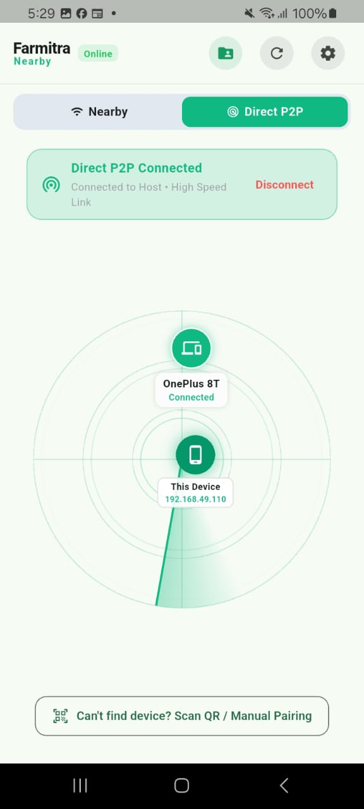
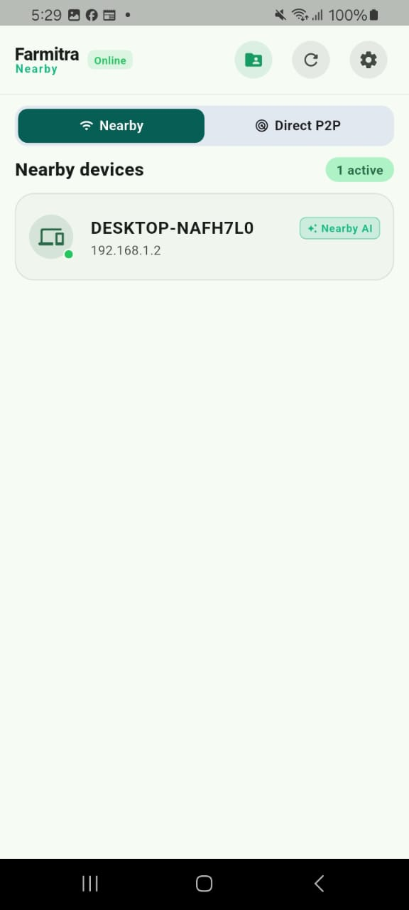
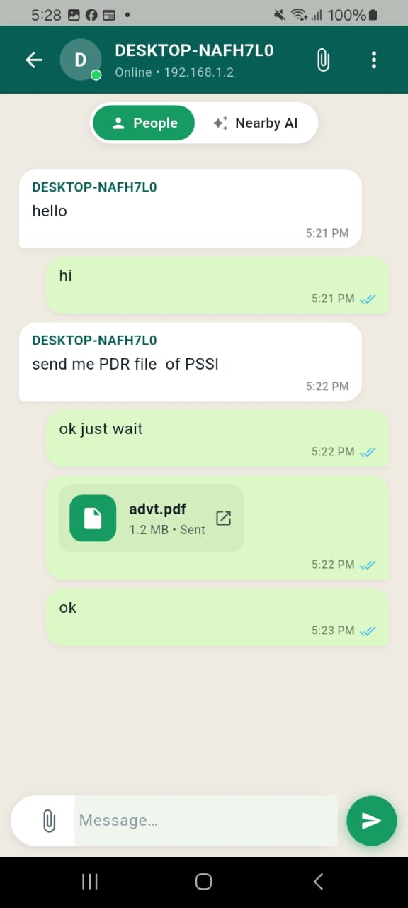
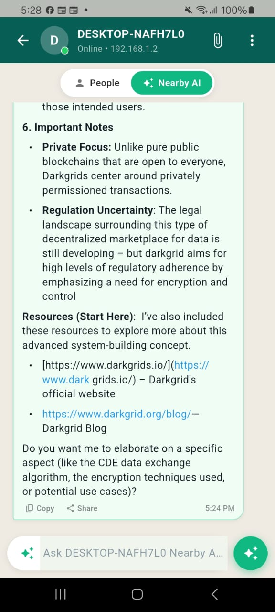
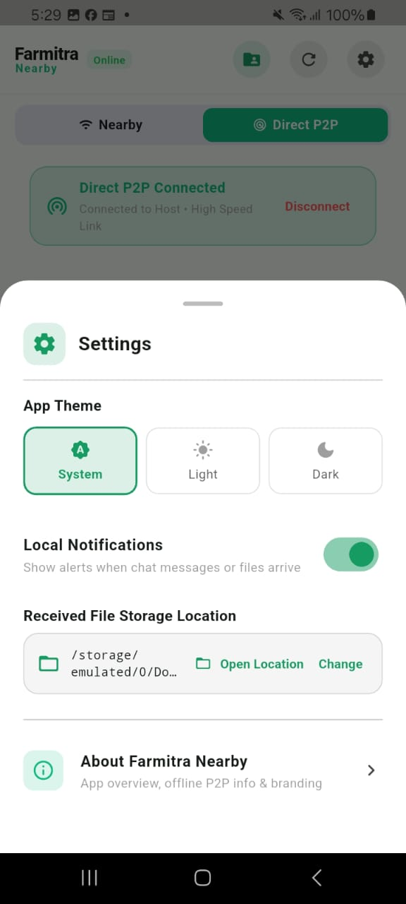
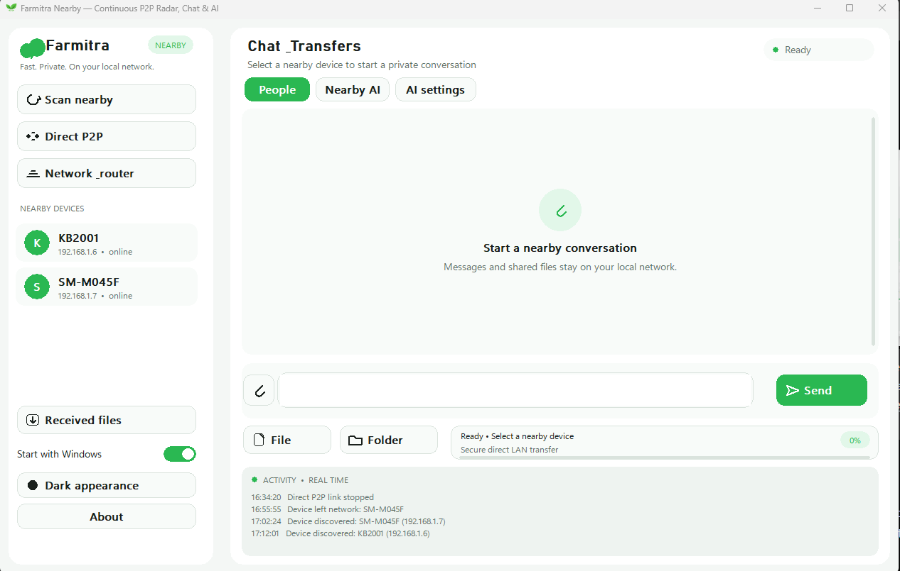
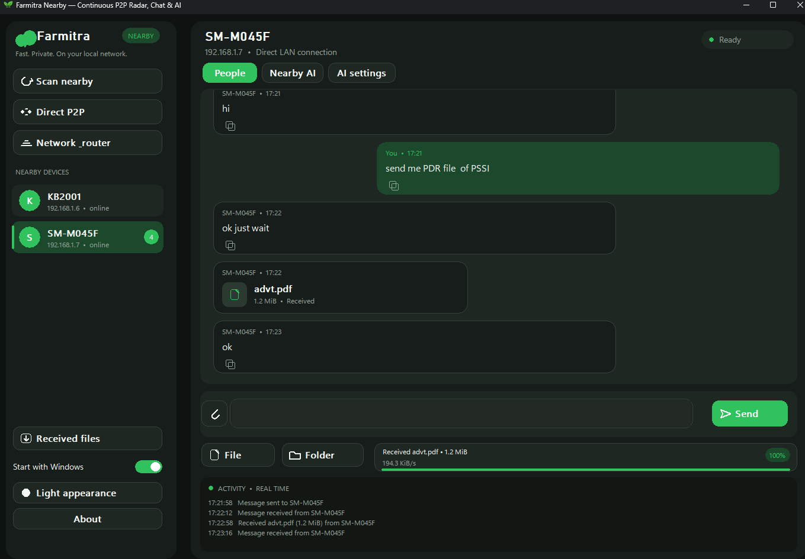
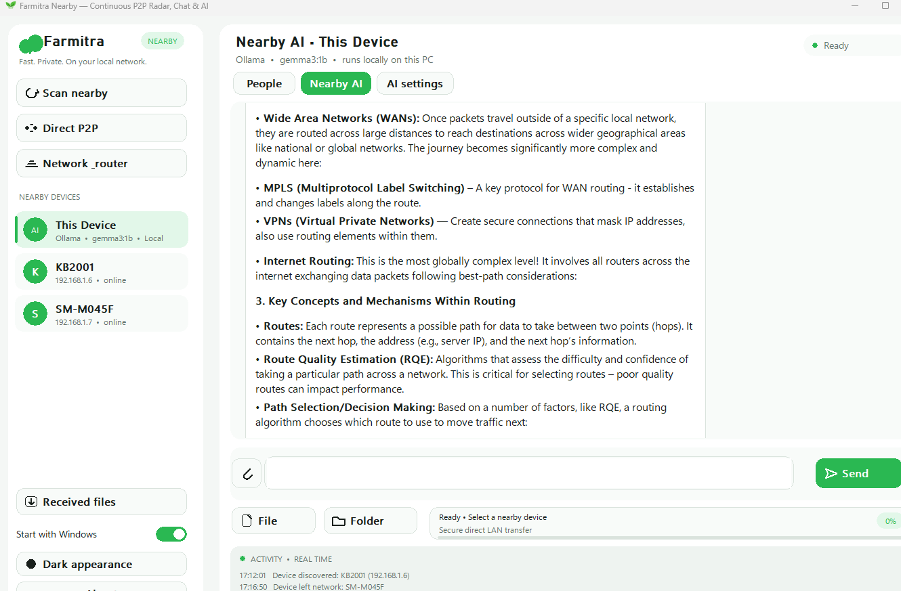
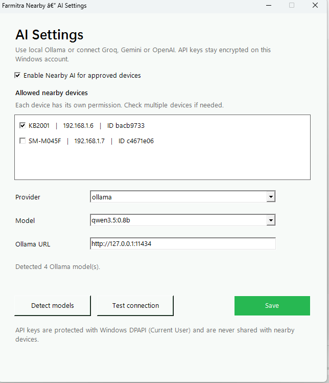

# NearMitra: High-Speed, Offline P2P & LAN Communication Framework

NearMitra is a private, local network and direct peer-to-peer (P2P) communication platform providing decentralized AI model sharing, multi-hop mesh messaging, high-speed file transfer, live CCTV/audio streaming, and WebRTC calling. It operates **100% offline without internet connections, cellular data, or external cloud infrastructure**.

---

## Cross-Platform Architecture (Android Mobile & Windows Desktop)

NearMitra bridges mobile devices and desktop workstations across local Wi-Fi networks and direct Wi-Fi Direct links:

- **Android Mobile Application**: Native Flutter + Kotlin integration featuring a 60 FPS P2P Radar, live camera QR pairing, scoped storage file pipeline, WebRTC audio/video calling, live CCTV/audio streaming, persistent outbox queue, and Android Quick Settings Tile.
- **Windows PC Desktop Application**: Desktop workstation application with direct P2P link support, real-time activity tracker, local Ollama AI hosting, and system tray integration.

---

## App Visual Showcase

### Section 1: Android Mobile Interface

| 60 FPS P2P Radar View | Nearby LAN Devices List | Chat & File Transfer |
| :---: | :---: | :---: |
|  |  |  |

| Nearby AI Client Chat | Streaming Hub | App Settings |
| :---: | :---: | :---: |
|  |  |  |

---

### Section 2: Windows Desktop Interface

| Windows Interface & Device List | Windows Chat & High-Speed File Transfer (Dark Theme) |
| :---: | :---: |
|  |  |

| Windows Local Ollama Nearby AI Host | Windows AI Host Security & Model Settings |
| :---: | :---: |
|  |  |

---

## Core Pillars & Key Features

### 1. Decentralized Nearby AI & Heterogeneous Model Sharing Hub (Primary Feature)

#### The Problem:
Modern artificial intelligence workflows require diverse, specialized models:
- **Vision Models**: For image analysis, crop disease inspection, and visual defect detection.
- **Deep Reasoning Models**: For mathematical logic, coding, and structured planning.
- **Domain-Specific Models**: Specialized weights for healthcare/first-aid, agriculture, or engineering.
- **Lightweight General Chat Models**: Fast conversational assistants.

No single mobile smartphone possesses sufficient RAM, GPU compute, or battery capacity to host and execute multiple heavy on-device models simultaneously. Furthermore, individual users cannot maintain multiple paid API subscriptions for diverse models.

#### The NearMitra Solution:
NearMitra introduces a **Local Peer-to-Peer AI Model Sharing Protocol**:
- **Workstation as Local AI Host**: A single desktop PC (equipped with GPU running Ollama/LocalAI) or a high-end mobile node acts as a local AI Host on the network.
- **Zero-Cloud LAN Querying**: Any lightweight client on the local network or direct P2P link can dispatch prompts and receive real-time streaming responses from these specialized models.
- **Model Interoperability**: Clients can request different models hosted across the network (e.g., query a vision model on Node A, a reasoning model on Node B, or a domain-specific model on Node C) without installing heavy model weights locally.
- **Granular Security Controls**: AI Host nodes maintain complete control with persistent per-peer access whitelisting and revocations.

```
┌─────────────────────────────────────────────────────────────────────────────┐
│                 NearMitra Decentralized AI Sharing Topology                 │
├─────────────────────────────────────────────────────────────────────────────┤
│                                                                             │
│   [ Client Phone A ] ───(P2P / LAN Socket)───► [ Local AI Host (PC) ]       │
│   • Asks Vision Prompt                         • Runs Ollama / GPU Weights  │
│                                                • Llama-3 / Gemma / Phi-3    │
│                                                                             │
│   [ Client Phone B ] ───(P2P / LAN Socket)───► [ Domain AI Node (Phone) ]   │
│   • Asks Medical / Crop Prompt                 • Runs Domain-Specific SLM   │
│                                                                             │
└─────────────────────────────────────────────────────────────────────────────┘
```

---

### 2. Integrated Multi-Hop Mesh Relay Architecture

NearMitra contains a built-in **Multi-Hop Mesh Networking Engine** designed for off-grid scenarios:

#### Why Mesh Relay is Integrated:
- In remote areas, disaster zones, or dense buildings, two devices may be out of direct Wi-Fi range or separated by physical obstacles with no central router available.
- NearMitra nodes automatically act as cooperative relay bridges. When Node A sends a packet to Node C, intermediate Node B forwards the packet transparently.
- **Loop Prevention & TTL**: Includes unique 64-bit message deduplication rings, dynamic Hop-Count tracing (`A -> B -> C`), and Time-To-Live (TTL) decrements to ensure network bandwidth efficiency.

---

### 3. Dual Link Layer: Direct P2P & Nearby LAN Modes

- **Direct P2P Mode (Wi-Fi Direct v7.1 Radar)**: Establishes a direct high-throughput hardware link between two devices without requiring an external Wi-Fi router, hotspot, or internet connectivity.
- **Nearby Mode (LAN Discovery)**: Automatically discovers all peers on a shared Wi-Fi network or hotspot using zero-configuration UDP multicast (`239.255.43.88:43888`) and subnet scans.
- **Hardware Type Identification**: Automatically identifies nodes as Android phones, Windows PCs, or generic hardware with dedicated icons.

---

### 4. 60 FPS Continuous P2P Radar & Smart Setup

- **60 FPS Hardware Sweep**: Continuous rotating radar sweep arc with expanding wave pulses and fading trails.
- **Dynamic Hardware Diagnostics**: Detects Wi-Fi or Location (GPS) states on Android and presents 1-tap action banners to enable required radios without navigating through settings menus.
- **Built-in QR Scanner**: Integrated camera scanner with animated laser reticle for 1-tap Wi-Fi Direct MAC pairing.

---

### 5. Offline Outbox Queue (Store & Forward Auto-Sync)

- **Persistent Outbox Queue**: Messages and files sent to offline or temporarily unreachable peers are preserved in local storage (`SharedPreferences`).
- **Visual Status Badges**: Displays a distinct **Queued** status indicator on pending bubbles.
- **Auto-Sync on Reconnect**: When the target peer is discovered online, the background queue manager automatically flushes pending items in chronological order.
- **In-Chat Cancellation**: Users can cancel or delete queued items directly from the chat bubble prior to delivery.

---

### 6. Real-Time Audio & Video Calling (WebRTC P2P)

- **P2P HD Voice & Video Calls**: Direct device-to-device audio and video streams powered by WebRTC over local sockets.
- **Full-Screen Call Interface**: Audio mute, camera flip, speakerphone switching, and call duration tracking.
- **Background Call Delivery**: Integrated with native Android full-screen incoming call notifications even when the application is backgrounded or the screen is locked.

---

### 7. Live Streaming Hub (CCTV & Audio)

- **CCTV Video Feed**: Stream live camera feeds from one device to any authorized peer on the network.
- **Live Microphone Audio**: Broadcast live low-latency audio to connected nodes.
- **Security & Authorization**: Persistent per-device permission management for camera, audio, and screen streaming access.

---

### 8. High-Speed Offline File & Folder Transfer

- **High Throughput Transfers**: Exchange documents, media, APKs, and compressed archives at full hardware Wi-Fi link speeds (up to 50+ MB/s).
- **Live Transfer Metrics**: Real-time progress indicators, transfer speed (MB/s), and estimated time remaining (ETA).
- **1-Tap File Opener**: Native integration to open or install received files directly from chat history.

---

### 9. Android Quick Settings Tile (`NearMitra Share`)

- **Notification Shade Tile**: Native `TileService` allows 1-tap application launch directly from Android Quick Settings (alongside Wi-Fi and Bluetooth).
- **Monochrome Vector Icon**: Clean vector drawable (`ic_qs_nearmitra.xml`) that dynamically tints across Android Light and Dark system themes.
- **Status Indicator**: Displays current P2P background listener state.

---

### 10. Native Android Background Service

- **Foreground Socket Daemon**: Native `FarmitraForegroundService` with `WAKE_LOCK`, `WifiLock`, and `MulticastLock` maintains socket listeners when minimized or locked.
- **Run in Background Switch**: Configurable toggle in App Settings with persistent state.

---

## Technical Architecture & Wire Protocol

NearMitra uses a low-overhead JSON-over-Socket wire protocol compatible across Android and Windows implementations:

| Component | Protocol / Port | Purpose |
| :--- | :--- | :--- |
| **UDP Discovery** | `UDP 239.255.43.88:43888` / Broadcast | Device presence announcement & IP discovery |
| **TCP Socket Transport** | `TCP 0.0.0.0:43889` | Chat messages, file payloads, typing indicators, AI prompts |
| **WebRTC Signaling** | TCP Socket Overlay | Session Description Protocol (SDP) and ICE candidate exchange |
| **Wi-Fi Direct P2P** | Android `WifiP2pManager` | Point-to-point Wi-Fi Direct subnet link formation (`192.168.49.x`) |

### Packet Header Schema (JSON + `\n`):

```json
{"type":"hello","sender":"Device Name","sender_id":"uuid-id"}
{"type":"chat","sender":"Device Name","sender_id":"uuid-id","message":"Message content"}
{"type":"ai_chat","sender":"Device Name","sender_id":"uuid-id","prompt":"Prompt query","ai":true}
{"type":"file","sender":"Device Name","sender_id":"uuid-id","name":"document.pdf","size":1048576}
{"type":"mesh_relay","msg_id":"unique_id","origin_id":"origin_uuid","target_id":"target_uuid","ttl":4,"hops":["NodeA"],"payload":{"type":"chat","message":"Mesh content"}}
{"type":"webrtc_offer","sender":"Device Name","sender_id":"uuid-id","sdp":"...","is_video":true}
```

---

## Future Roadmap & Technical Vision

```
┌───────────────────────────────────────────────────────────────────────────────┐
│                           NearMitra Future Roadmap                            │
├───────────────────────┬───────────────────────────────┬───────────────────────┤
│    Edge AI & Vision   │     Acoustic Protection       │ Universal Ecosystem   │
│  • On-Device SLMs     │  • Theft & Intrusion Audio    │  • iOS, macOS, Linux  │
│  • Real-Time CV Alert │  • Anomaly Sound Detection    │  • Advanced Mesh P2P  │
│  • Edge Object Filter │  • Acoustic Alarm Trigger     │  • Shared Clipboard   │
└───────────────────────┴───────────────────────────────┴───────────────────────┘
```

### 1. On-Device Local SLM Execution (NPU / GPU Acceleration)
- Execute quantized Small Language Models (e.g., Google Gemma 2B, Llama 3.2 1B/3B, Microsoft Phi-3) directly on-device using MediaPipe, GGML, and TFLite runtimes.
- Enables zero-network, zero-cloud text generation and assistance on standalone hardware.

### 2. Condition-Based AI Vision Filtering in CCTV Streaming
- Real-time computer vision inference applied directly to CCTV camera streams:
  - **Intrusion Detection**: Automatic silent alerts dispatched over P2P upon human presence in restricted zones.
  - **Property & Agricultural Protection**: Object classification for livestock, stray animals, or vehicle entry with bounding-box telemetry.
  - **Hazard Detection**: Edge alerts for fire, smoke, and industrial hazards.
  - **Bandwidth Optimization**: Streams high-bitrate video feeds only when specified visual trigger conditions are met.

### 3. AI-Powered Acoustic Anomaly & Theft Protection
- Real-time local sound classification applied to live audio streams:
  - **Animal Distress & Barking Recognition**: Identifies canine distress or unusual nocturnal livestock sounds to deter farm/property theft.
  - **Break-In Detection**: Acoustic recognition for glass shattering, door tampering, and distress calls.
  - **Automated P2P Siren Broadcast**: Triggers automated sirens or flashlights on remote CCTV nodes upon anomaly detection.

### 4. Cross-Platform Ecosystem Expansion
- Extending native P2P direct connectivity across **iOS, macOS, and Linux**.
- Encrypted cross-device shared clipboard synchronization.

---

## Building the Application

### Prerequisites:
- Flutter SDK (v3.19+)
- Android SDK (API Level 26+ / Android 8.0+)
- Java JDK 17

### Build Commands:

```bash
# Get dependencies
flutter pub get

# Build architecture-specific Release APKs
flutter build apk --split-per-abi
```

**Generated Binaries**:
- `build/app/outputs/flutter-apk/app-arm64-v8a-release.apk` (64-bit Modern Android)
- `build/app/outputs/flutter-apk/app-armeabi-v7a-release.apk` (32-bit Legacy Android)

---

## Privacy & Security Model

- **100% Offline**: No network traffic ever leaves the local subnet or direct P2P link.
- **Zero Cloud Footprint**: No registration, no centralized user database, no telemetry tracking.
- **Deterministic Local Storage**: All settings, logs, and permissions remain strictly on local device storage.

---

© 2026 **NearMitra Ecosystem** • Built with Flutter & Native Android Frameworks.
