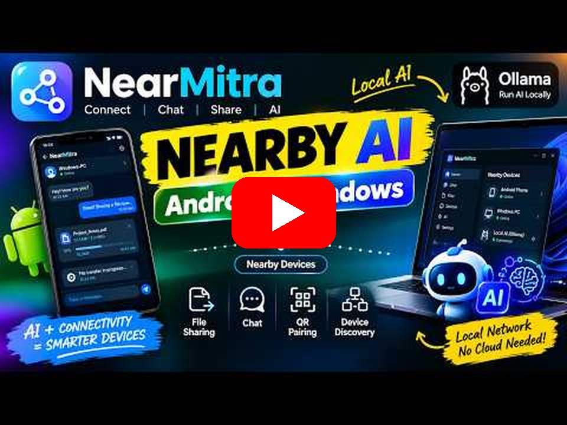

# NearMitra for Windows

NearMitra connects Windows PCs and Android phones for chat, file/folder transfer, calls, camera streams, standalone wireless audio and permission-based AI sharing. The current installer is **2.1.23**, targeting **Windows 10/11 x64**.

## Download & install

| Platform | Release | Download |
|---|---|---|
| Windows 10/11 x64 | 2.1.23 | [Download Windows setup](https://github.com/coderbaba0/nearmitra/releases/download/v2.1.23/NearMitra_Setup_2.1.23_x64.exe) |
| Android companion | 1.0.3 · build 4 | [Download Android APK](https://github.com/coderbaba0/nearmitra/releases/download/v1.0.3/NearMitra-Android-1.0.3.apk) |

[Windows release notes](https://github.com/coderbaba0/nearmitra/releases/tag/v2.1.23) · [Android release notes](https://github.com/coderbaba0/nearmitra/releases/tag/v1.0.3) · [Website](https://coderbaba0.github.io/nearmitra/) · [All releases](https://github.com/coderbaba0/nearmitra/releases)


The active desktop launcher is a Go backend with an embedded HTML/CSS/JavaScript interface opened in a Windows browser app window, plus native Win32 tray, picker, audio and Explorer integrations. Older native-renderer code and historical screenshots remain in the repository; they are not the current UI specification.

## Updates included in 2.1.23

Current Windows release: **2.1.23**. Android companion: **1.0.3 (versionCode 4)**. Use the GitHub Release downloads above, or follow the build instructions below to create your own binaries.

| Versions | Changes |
|---|---|
| 2.1.1–2.1.10 | Capture-device handling, separation of microphone/camera calls from explicit screen/tab audio capture, standalone Wi-Fi Audio signaling and approval, script-serving fixes, capture cleanup, sidebar/picker improvements, mobile speaker-routing feedback and measured audio animation. |
| 2.1.11 | Native WASAPI loopback for all-PC playback, active output selection, conversion using the actual device mix rate and bounded AudioWorklet buffering. |
| 2.1.12 | Live incoming files/folders in the sender's chat, bytes/speed/ETA, stable transfer IDs, theme-colored device/Chat unread counts and Windows phone-location status/timeouts. |
| 2.1.13 | Default-checked minimized auto-start; native shortcut/registry/uninstall steps; optional private-network firewall setup without PowerShell. |
| 2.1.14 | Incoming mobile reactions/removal, quoted replies and original-message navigation, message/file multi-selection and forwarding; persistent outgoing attachment identities and browser-selected bytes. |
| 2.1.15 | `flutterfever.com` publisher branding and optional certificate-store signing/verification in the release build. The available setup remains unsigned. |
| 2.1.16 | Selected-device Nearby AI separated from My AI; per-device Allow/Revoke; actual Ollama response streaming, loading heartbeats, Stop and mid-stream permission checks. |
| 2.1.17 | Native Explorer Open Folder / Show in Folder, exact full-path window matching, foreground/restoration of existing folder windows, and actual error feedback. |
| 2.1.18 | Connected-call video upgrades explicitly enable the negotiated video sender; screen/camera switching preserves audio and restores the prior track/direction after a failed upgrade. |
| 2.1.19 | Copy beside Select in message hover actions, clipboard feedback/fallback, and configured desktop avatars included in discovery handshakes and preserved across rescans. |
| 2.1.20 | Refresh typing while composing, preserve WAN typing across state polls, match device identities, and handle stop/expiry per conversation. |
| 2.1.21 | Background TCP hello checks keep reachable local apps online when UDP beacons are missed; unified local-first status, WAN read failure handling, and serialized state polling prevent false offline updates. |
| 2.1.23 | Restored the drag-drop upload endpoint; online drops send all selected files through the existing Nearby-first/WAN routing, while offline drops show a clear message. |
| 2.1.22 | Versioned rebuild of the current desktop source; retains the Copy, avatar, typing and background presence fixes from 2.1.19–2.1.21. |

Android 1.0.3 is available as a [GitHub Release APK](https://github.com/coderbaba0/nearmitra/releases/download/v1.0.3/NearMitra-Android-1.0.3.apk). The recent-apps swipe-away notification issue remains unresolved; this rebuild does not add a fix for that Android lifecycle case.

## Install or upgrade

1. Build the setup as described below, or use the installer supplied separately by the maintainer.
2. Exit old NearMitra tray/portable copies, [download the Windows 2.1.23 setup](https://github.com/coderbaba0/nearmitra/releases/download/v2.1.23/NearMitra_Setup_2.1.23_x64.exe), and run `NearMitra_Setup_2.1.23_x64.exe`.
3. Choose preferences. **Auto-start NearMitra minimized when Windows starts** is checked by default and can be unchecked.
4. Optional **Allow Nearby on private networks** requests administrator approval for the setup executable. It adds inbound TCP/UDP rules limited to this program, the private profile and local subnet. Declining approval still completes installation, but incoming discovery, files or calls may be blocked until allowed in Windows Firewall.
5. Launch the installed copy. The tray icon may be inside Windows' notification overflow.

Installation path: `%LOCALAPPDATA%\Programs\NearMitra`.

The normal per-user shortcut/registry/uninstall flow does not use PowerShell. Uninstall preserves chats and received files. Setup is **unsigned**: changing the Publisher string does not remove UAC's **Unknown publisher** or provide SmartScreen reputation. No no-UAC/default-disabled-firewall change was made. See [WINDOWS_SIGNING.md](WINDOWS_SIGNING.md) for trusted signing requirements and the configured build flow.

Executable installers/APKs, user data, logs and build output are excluded from source control. A GitHub source push does not create a Release or upload an installer.

## Connect a phone

Run NearMitra on both devices. Windows can stay minimized in the tray; Android can use Home/minimize with Run in Background enabled. Use Nearby on the same reachable local network, or establish a supported Wi-Fi Direct/P2P link. Select the actual NearMitra peer in the device list; a discovered router or generic LAN host is not an app peer. For direct IP fallback use Connect IP.

Direct discovery uses UDP `43888`; chat, file transfer, AI and local media signaling use TCP `43889`. WebRTC negotiates its own media/data paths. Windows network profile/firewall, VPNs and access-point client isolation can affect reachability.

WAN uses configured Firebase presence/signaling and WebRTC sessions. It is optional, and stale Windows heartbeats expire instead of keeping a shut-down PC online forever.

### Online status and connection priority

- The same routing decision drives chat status and message transport: reachable **Nearby LAN/P2P first**, then an enabled, trusted **WAN** connection, otherwise **Offline** with queued messages.
- Windows discovery and WAN heartbeat workers run in the Go backend, independently of the browser window or selected sidebar tab. Keep the app in the tray; Exit stops the process.
- Quiet local peers are checked using an actual NearMitra TCP hello after an 8-second beacon gap. Without a new beacon or successful hello, local presence expires after 25 seconds, checked on a 5-second cadence. An open unrelated TCP port is not enough to confirm app presence.
- A WAN offline update cannot overwrite a working local connection. Temporary Firebase read failures retain cached desktop presence within its heartbeat lease; explicit offline records and lease expiry still apply.
- LAN scans and legacy beacons preserve learned device/cloud identity and configured avatars. State requests are serialized to avoid overlapping polls.

### Android background notification limitation

Android 1.0.3 restores Internet presence at startup without opening the WAN tab and respects saved Internet OFF. With Run in Background ON, double-Back on the home screen minimizes the task. **Swiping the app away from Recent apps still has an unresolved delivery/notification issue**: the foreground-service notification can outlive the activity-owned Flutter networking runtime. Messages may appear after reopening. This APK rebuild does not add an activity-independent engine; do not treat it as a verified fix for swipe-away or killed-state delivery.

## Chat and file handling

- Available Nearby routes take priority while device identity links keep Nearby/WAN chat history together.
- Incoming file/folder items appear during reception in the sender's chat with bytes, percentage, average speed and estimated remaining transfer time. Folder ETA covers the archive payload; extraction time is not predicted. Completion replaces the same item after storage succeeds.
- Device cards and Chat show unread counts using the theme. Reading another peer does not clear the sender's badge. The relevant chat must be visible/focused to mark it read.
- Mobile reactions and removal render on desktop. A local reaction is kept separately from the peer's reaction.
- Reply includes an original-message quote and a jump action when the original remains in history. Changing conversations clears an unsent reply preview.
- Hover/focus a completed message or file for **Reply**, **Forward**, **Select**, and **Copy**. Copy writes the message text (or an attachment name when no message text exists) to the clipboard and shows success/failure feedback. Select several items, choose **Forward**, then search/select a connected Nearby/P2P or enabled trusted WAN recipient. Successful items leave the pending selection; failed items show an error and remain available for retry.
- Forwarding uses a new message ID and does not carry a private quote from the source conversation. A file must still exist locally. Older records without a saved path/bytes cannot be recovered automatically.

Chat/configuration live under `%APPDATA%\NearMitra`; received files use the configured save directory. Browser-selected outgoing files are retained under `SentAttachments` beside chat history for later forwarding. Native-picker files retain their original path. Protect or remove retained files according to your local storage requirements.

## Voice, calls and Wi-Fi Audio

Normal voice/video calls capture microphone/camera; they do not ask to share a browser tab. Screen sharing is an explicit connected-call control. Media switching and Stop/disconnect release the corresponding tracks. A PC without a microphone can receive phone audio; sending microphone sound requires an available input.

Standalone wireless audio is in **Voice → Broadcast PC Audio to Phone → Wireless audio controls**. On Android it is **Streaming → Wi-Fi Audio**. It is separate from calls and CCTV and requires the current companion APK, direct Nearby/P2P reachability and owner approval.

### PC music/YouTube → phone speaker

1. Select the Nearby phone in the shared target selector.
2. Choose system audio and **All PC apps**. Select the same Windows playback output used by Chrome or your desktop player.
3. Start playback, choose **Send PC audio**, and approve playback on Android.
4. Use the phone's output control and volume; Stop is available on both devices.

All-PC mode uses native WASAPI loopback; it does not capture screen video. A physical speaker/headphone is not required if an active virtual playback output is installed and configured. Without any active physical/virtual render endpoint, desktop-player audio cannot be captured. NearMitra does not bundle/install a virtual audio driver.

**A tab in this app's browser** remains a separate capture mode: select an audible tab and enable Share tab audio. An Edge tab picker does not expose Chrome tabs; use All PC apps for other browsers/players.

### Phone mic → PC

Select the phone and choose **Use phone mic**, then approve microphone capture on Android. Its audio plays inside NearMitra. Using the phone as another Windows application's selectable microphone requires a separate virtual audio-routing device.

Android source includes speaker/earpiece routing result checks and an animation driven by measured WebRTC audio energy. Source-rate conversion and bounded buffering improve the transport, but live latency and reported low-pitch/slow-playback problems still require hardware verification.

## Nearby AI and My AI

| View/control | Meaning |
|---|---|
| Device chat → Nearby AI | Queries the selected connected device's shared engine, subject to its owner's grant. It does not use this Windows PC's engine as a fallback. |
| My AI settings / AI Hub | Configures this Windows PC's own provider, model and credentials. |
| Share my AI with this device → Allow | Enables desktop sharing if necessary and grants the selected phone access to this PC's configured engine. Other phones need separate grants. |
| Revoke | Removes this device's access. Global sharing can also be disabled. |

For Windows Ollama hosting, configure/enable Ollama and select an installed model in My AI settings. Select the phone's chat, allow it, then query the Windows peer's Nearby AI from the phone. Windows forwards actual Ollama response chunks; loading heartbeats, Stop/disconnect cancellation and per-chunk access checks prevent misleading completion and continue enforcing revocation. Remote prompts do not overwrite the owner's My AI state.

To use a phone's engine from Windows, that phone must configure its own AI and separately allow the Windows device. Denied access and unavailable devices show errors. Device-chat Nearby AI currently requires a direct Nearby/P2P peer; WAN-only AI is not added here. Ollama has incremental generation; other configured cloud providers retain their current response behavior and need their provider credentials/internet access.

Mobile source also removes silent fallback to its own engine on remote failure. The Android 1.0.3 APK includes this correction and the mobile background presence fixes. The existing mobile streaming reader already understands the Windows Ollama stream packets.

## Phone sensors, IoT and CCTV

Windows IoT requests an owner-approved phone battery/location snapshot. Location requires Android permission and an enabled provider; source updates handle approximate permission, recent fixes and fresh GPS/network readings. This does not start continuous background tracking. See [IOT_SETUP.md](IOT_SETUP.md) for gateway contracts, relay timers, scale/soil/NFC support and physical-hardware limitations.

CCTV transport/recording and visual diagnostic controls should not be confused with a deployed AI analytics system. Warehouse/person counting, a persistent identity/counting database and male/female classification were discussed and deferred. Labels or demonstration visuals do not implement those pipelines. No new counting database was introduced.

## Explorer and pickers

Native file pickers use the initiating foreground window as owner. Open Folder, the top-right folder icon, Show in Folder and CCTV recordings use Windows Shell APIs. Explorer is matched by its decoded full folder path; an existing/minimized matching window is raised/restored and a requested item is selected. No permanent always-on-top window, simulated keystrokes or global focus-policy changes are used. If the user switches to another application while opening, the helper avoids taking focus from it; Windows foreground policy can still restrict activation.

## Video walkthrough

See how to use NearMitra in this YouTube walkthrough. Click the preview or **▶ Play video** to open the video at **0:24**.

<p align="center">
  <a href="https://www.youtube.com/watch?v=M79xzZUn_0Q&amp;t=24s" title="Play the NearMitra usage walkthrough on YouTube">
    
  </a>
  <br />
  <a href="https://www.youtube.com/watch?v=M79xzZUn_0Q&amp;t=24s"><strong>▶ Play video — How to use NearMitra</strong></a>
</p>

## Build from source

Requirements: Windows 10/11 x64, Go 1.23 or newer, and a browser supported by the current app-window launcher. Node.js is needed for JavaScript tests. The Flutter/Android SDK is needed only when building/running the separate mobile project.

Run in this directory from a Windows terminal:

```bat
build-installer.bat
go test ./...
node --test --test-reporter=dot internal/ui/web/*.test.cjs installer/web/app.test.cjs
```

Local outputs:

```text
build\windows-release\NearMitra.exe
build\windows-release\NearMitra_Setup_2.1.23_x64.exe
```

Run the build first on a fresh clone: the installer embeds `installer/NearMitra.exe`, which is generated and intentionally not committed. The build copies the current app into the setup's embedded payload. Installer tests compare its bytes with the release app. If a trusted certificate is configured, the app is signed/verified before embedding, then setup is signed/verified; configured signing failures abort the build. Without a certificate, output remains explicitly unsigned.

`SHA256SUMS.txt` records maintainer build hashes; rebuilds/toolchain changes or signing can change them. Regenerate hashes from final signed/unsigned artifacts before distributing them.

## Validation and remaining checks

- Windows Go tests cover transport/storage, peer-scoped reactions, reply metadata, forwarding, permission grants/revocation, controlled Ollama streaming, TCP-to-HTTP relay, cancellation, WASAPI format conversion, asset serving and installer extraction/payload integrity.
- **136** JavaScript tests cover desktop/installer behavior, including capture cleanup, signaling, progress/unread badges, quoted replies, forwarding, typing refresh/expiry, Nearby-first online status, serialized polling, device AI routing and folder errors.
- An opt-in interactive Windows Explorer test opens a unique temporary folder, places a temporary app window in front, invokes Show in Folder and verifies that the exact Explorer window becomes foreground. It closes its own test windows afterward.
- Android Nearby service static analysis passes. All **77 mobile tests** pass, covering call media state, conversation routing, presence expiry, wireless-audio signaling and output/meter UI. Android `:app:compileDebugKotlin --offline` also succeeds; Android 1.0.3 is built at `../build/releases/NearMitra-Android-1.0.3.apk`, with startup/background presence fixes; its native release Kotlin compilation also succeeds.
- The reported Android Recent-apps swipe-away notification issue remains unresolved. Live two-device tray, screen-off and network-switch tests are still required.
- Actual phones, cameras, audio endpoints, drivers, GPS reception and IoT hardware still require device-specific testing. Automated mocks and successful transport connection do not establish audible playback, perfect latency or working AI vision models.

## Security and data handling

Direct LAN chat/file/AI use the current JSON/TCP wire protocol; do not treat every LAN payload as AES/end-to-end encrypted. WebRTC media/data-channel transport is separate. Peer allowlists enforce application permission and are not cryptographic device authentication. WAN uses configured Firebase services; cloud AI reaches its selected provider. Keep provider keys, signing credentials, received/sent files and personal configuration outside public source commits.

## License

NearMitra's Android app and Windows desktop source code are licensed under the **GNU General Public License, version 3 only** (`GPL-3.0-only`). See the full [LICENSE](../LICENSE).

When distributing covered software or modified versions, comply with GPLv3's source-code and license-notice requirements. The software is provided without warranty, as described in the license. Third-party dependencies and bundled components retain their respective licenses.

## Configure your own Firebase for WAN / Internet

The repository includes **no shared Firebase project or maintainer database endpoint**. Nearby LAN/P2P works without Firebase. For Internet/WAN, follow the [Firebase setup guide](../docs/FIREBASE_SETUP.md) and use your own development project on both devices.

1. Register your Android package in Firebase, create a **Realtime Database**, and keep your downloaded `android/app/google-services.json` local (Git-ignored).
2. Keep your own `google-services.json` locally with `project_info.firebase_url` set to your RTDB URL; normal Android run/build commands use it automatically. Alternatively, copy `config/firebase.example.json` to the ignored `config/firebase.local.json` and pass `--dart-define-from-file=config/firebase.local.json`.
3. The native Windows app does **not** use `google-services.json`. For normal builds, keep your own endpoint in the ignored `internal/wan/firebase_config.local.go` described in the guide. Alternatively, set `NEARMITRA_FIREBASE_RTDB_URL` before launching it, or configure `firebase_rtdb_url` in `%LOCALAPPDATA%\NearMitra\wan_config.json`. Use the same database as the phone.
4. Use the documented local emulator for integration tests. Current clients lack Firebase Authentication tokens; locked hosted rules reject them. Add authentication/authorization before public hosted deployment; never deploy the permissive emulator rules to production.

See the guide for exact config fields, emulator commands, required data paths and old-release/history limitations. Old APKs/EXEs and previously saved runtime settings can retain the former project; branch cleanup does not revoke access to those copies.

## Contributing

Contributions to the Android and Windows apps are welcome. Read the [contribution guide](../CONTRIBUTING.md) for development setup, the `develop` branch workflow, relevant checks, device testing and pull request expectations. Bug reports, documentation, accessibility improvements and regression tests are welcome too.

See the [project README](../README.md), [feature/hardware notes](IOT_SETUP.md) and [signing guide](WINDOWS_SIGNING.md).
